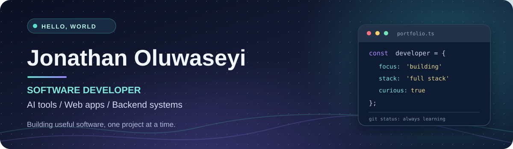

  
   
   
  
  
   
   
  
  

## 👋 About me

I'm **Jonathan Oluwaseyi**, a software developer based in **Moncton, New Brunswick, Canada**. I have a BSc in **Computer Science from Landmark University** and I'm currently studying at **NBCC**.

I enjoy turning practical problems into working software, from **AI-powered productivity tools** to **web applications and backend systems**. I'm developing my skills through projects involving Python, C#, JavaScript, Java, C++, SQL, and ASP.NET Core.

- 🔭 **Building:** More reliable AI apps, APIs, and full-stack projects
- 🌱 **Learning:** Software architecture, database-backed applications, and applied AI
- 🎯 **Goal:** Grow into a well-rounded software developer and contribute to impactful products
- 🤝 **Interested in:** Software development internships, collaborative projects, and learning from other developers

## 🧰 Tech stack

**Languages**

**Web, backend and tools**

## 🚀 Featured projects

| Project | What it does | Stack |
| :--- | :--- | :--- |
| **[AI Resume Match](https://github.com/Jonathan-Seyi/ai-projects/tree/main/ai-resume-match)** | Compares resumes with job descriptions and offers improvement suggestions and interview questions. Includes a local heuristic fallback. | Python, Streamlit, optional LLM |
| **[AI Support Ticket Assistant](https://github.com/Jonathan-Seyi/ai-projects/tree/main/ai-support-ticket-assistant)** | Summarizes support requests, classifies issues, and drafts suggested responses. | Python, Streamlit, LLM workflow |
| **[AI Notes Chat](https://github.com/Jonathan-Seyi/ai-projects/tree/main/ai-rag-notes-chat)** | Retrieves relevant note excerpts before generating a response to a question. | Python, Streamlit, retrieval |

  <a href="https://github.com/Jonathan-Seyi/ai-projects"><b>Explore the AI projects repository →</b></a>

## 📊 GitHub activity

  
  

Stats and language charts are generated by third-party GitHub widgets. Language usage is based on repository contents, not a measure of expertise.

## 📍 What I'm working toward

I use this account to document software I build and the skills I develop. My focus is on small, useful projects with **clear READMEs, reproducible setup steps, and gradually improving tests**. Check back as the portfolio grows.

  Thanks for visiting. Feel free to explore a project or connect through GitHub.

